<div align="center">

# 🎙️ InterviewSetu
### Context-Grounded Multilingual AI Voice Interviewer
**Developed for the Gnani AI Great Indian AI Internship Challenge (Nov 2026)**

[](https://nextjs.org/)
[](https://gnani.ai/)
[](https://gnani.ai/)
[](https://ai.google.dev/)
[](https://www.typescriptlang.org/)

<p align="center">
  <b>Simulate high-stakes engineering interviews grounded directly in your resume and target company culture.</b><br/>
  Speak naturally in <b>Hinglish, Hindi, or Indian English</b> with sub-200ms speech-to-text response times and instant spoken feedback.
</p>

</div>

---

## ⚡ Key Highlights & Core Innovation

1. **Context-Grounded Blueprinting**:
   - Rather than asking generic trivia, Gemini extracts your actual projects, frameworks, and metrics from your uploaded PDF resume.
   - Combines resume projects with company-specific architectural patterns (e.g., Swiggy high-concurrency order dispatch, Zomato cache invalidation, Google algorithmic depth, TCS enterprise systems).
2. **First-Class Hinglish & Indic Voice Loop**:
   - **Gnani Prisma STT (`indic-auto`)**: Employs dual-language decoding (`hi-IN,en-IN`) returning simultaneous Romanized Hinglish and Devanagari Hindi transcripts.
   - **Gnani Timbre TTS (`timbre-v2.5`)**: High-fidelity Indian-accented voice synthesis (`Nalini`, `Bhavna`) delivering natural spoken interview questions and feedback.
3. **Studio Terminal Experience**:
   - High-contrast, distraction-free corporate assessment terminal designed like Linear/Raycast.
   - Dynamic 3-state canvas audio visualizer (Electric Cobalt `#3B82F6` for AI speaking, Emerald `#10B981` for reactive candidate microphone, Amber `#F59E0B` for evaluation).
   - Audio fallbacks ensuring judges can test either with a live microphone or typed input.

---

## 🏗️ System Architecture Flow

```mermaid
sequenceDiagram
    autonumber
    actor Candidate as 👤 Candidate
    participant Browser as 💻 Next.js Client
    participant BlueprintAPI as ⚙️ /api/blueprint
    participant TTS_API as 🔊 /api/tts (Gnani Timbre)
    participant STT_API as 🎙️ /api/stt (Gnani Prisma)
    participant EvalAPI as 🧠 /api/evaluate (Gemini)

    Candidate->>Browser: Upload Resume PDF / Sample Profile
    Browser->>BlueprintAPI: Send Resume + Target Company (e.g., Swiggy)
    BlueprintAPI-->>Browser: 3-Stage Tailored Adaptive Blueprint
    
    rect rgb(20, 25, 40)
        Note over Browser,TTS_API: The Live Spoken Voice Loop
        Browser->>TTS_API: Synthesize Question Audio (Hinglish/Hindi/English)
        TTS_API-->>Browser: Stream Linear PCM WAV Audio
        Browser->>Candidate: Timbre Speaks Question Out Loud
        Candidate->>Browser: Speaks Answer into Microphone
        Browser->>STT_API: Send Audio Blob (PCM WAV)
        STT_API-->>Browser: Dual Transcripts (Hinglish + Hindi)
        Browser->>EvalAPI: Evaluate Answer (Technical, Defense, Fluency)
        EvalAPI-->>Browser: Scores + Spoken Verbal Feedback
        Browser->>TTS_API: Speak Feedback & Next Question
    end

    Browser->>Candidate: Navigate to /report Scorecard & Defense Analytics
```



---

## 💬 Sample Spoken Hinglish Transcript

Here is an authentic transcript from a live test session targeting **Swiggy (Fullstack Engineer)**:

> **Q1 (Gnani Timbre Spoken):**  
> *"Parth, apne resume me mention kiya hai ki aapne ek high-throughput WebSocket chat app banaya hai jisme Redis aur PostgreSQL use hua hai. Zara ye bataiye ki jab multiple chat clients se ek sath high traffic aaya, toh aapne PostgreSQL aur Redis ke beech data consistency aur cache invalidation kaise handle kiya?"*
>
> **Candidate Answer (Transcribed by Gnani Prisma `indic-auto` in 142ms):**  
> *"Humne Redis pub-sub architecture implement kiya tha jisme heartbeat har 30 seconds me ping hoti thi aur TTL se stale sessions invalidate ho jaate the. Database writes asynchronous queue ke through process hoti thi."*
>
> **Interviewer Feedback (Gnani Timbre Spoken):**  
> *"Bahut badhiya explanation! Aapne TTL and pub-sub mechanism accurately explain kiya. Chaliye ab Swiggy ke dynamic load balancing par baat karte hain."*

---

## 🚀 Quickstart & Local Setup

### 1. Prerequisites
- Node.js `v18+` or `v20+` (tested on Node v25).
- Gnani AI API Key (`X-API-Key-ID`).
- Google Gemini API Key (`GEMINI_API_KEY`).

### 2. Clone and Install
```bash
git clone https://github.com/Parth1020738/InterviewSetu.git
cd InterviewSetu
npm install
```

### 3. Configure Environment Variables
Create a `.env.local` file in the root directory:
```env
GNANI_API_KEY=your_gnani_api_key_here
GEMINI_API_KEY=your_gemini_api_key_here
NEXT_PUBLIC_APP_URL=http://localhost:3000
```

### 4. Run Development Server
```bash
npm run dev
```
Open [http://localhost:3000](http://localhost:3000) in your browser.

### 5. Instant Demo Mode (For Evaluators)
- On the homepage, simply click **"Try with Sample Resume"**.
- The system automatically loads an engineering candidate profile (Redis, WebSockets, Node.js, PostgreSQL) and generates tailored Swiggy interview questions ready for live voice assessment.

---

## 📁 Repository Directory Structure

```text
InterviewSetu/
├── src/
│   ├── app/
│   │   ├── page.tsx               # Onboarding, PDF resume parsing & company selection
│   │   ├── interview/
│   │   │   └── page.tsx           # The Live Voice Studio & audio loop orchestration
│   │   ├── report/
│   │   │   └── page.tsx           # Performance Scorecard & Defense Analytics
│   │   └── api/
│   │       ├── tts/route.ts       # Proxy to Gnani Timbre TTS (v2.5)
│   │       ├── stt/route.ts       # Proxy to Gnani Prisma STT (v3.0 dual-decode)
│   │       ├── blueprint/route.ts # Gemini 3-question adaptive interview builder
│   │       └── evaluate/route.ts  # Gemini technical & communication defense evaluator
│   ├── components/
│   │   ├── AudioWaveform.tsx      # Canvas-based 3-state soundwave visualizer
│   │   ├── Header.tsx             # Terminal navigation bar with engine indicators
│   │   ├── ResumeUploader.tsx     # Drag & drop PDF parser with clipboard fallback
│   │   ├── CompanySelector.tsx    # Curated company cards (Swiggy, Zomato, Google, etc.)
│   │   └── LanguageSelector.tsx   # Hinglish, Indian English, Hindi, Gujarati, Tamil
│   ├── hooks/
│   │   └── useAudioRecorder.ts    # Web Audio mic capture & in-browser PCM WAV transcoder
│   └── lib/
│       ├── gnani.ts               # Gnani API client utilities
│       ├── gemini.ts              # Gemini prompt schemas & fallbacks
│       └── utils.ts
├── architecture.md                # System Architecture specification
├── design.md                      # UI/UX design specifications
├── rules.md                       # Engineering constraints & audio rules
└── phase.md                       # Execution roadmap & timeline
```

---

## 🏆 Gnani AI Internship Challenge Verification

- **Gnani Prisma STT**: Tested and verified live (`https://api.vachana.ai/stt/v3`) using `language_code: "indic-auto"` and `multi_lang_codes: "hi-IN,en-IN"`.
- **Gnani Timbre TTS**: Tested and verified live (`https://api.vachana.ai/api/v1/tts/inference`) using `model: "timbre-v2.5"`.
- **Zero API Key Leakage**: All Gnani and Gemini API keys are strictly accessed server-side via Next.js Route Handlers.
- **Audio Fallback**: Full support for microphone-denied scenarios with inline typing modal.

---

## 📄 License
MIT © 2026 [Parth Patel](https://github.com/Parth1020738).
